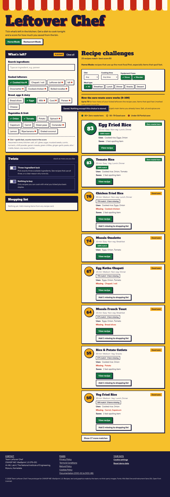
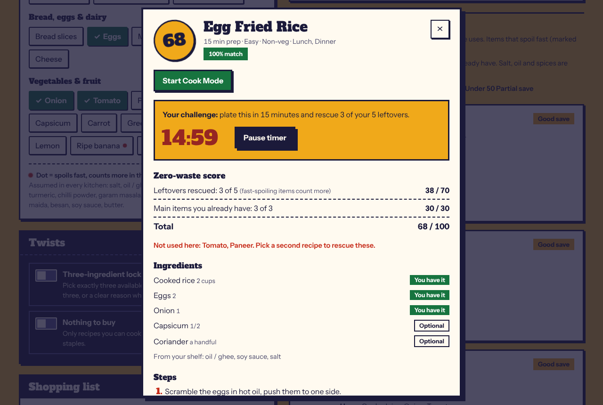
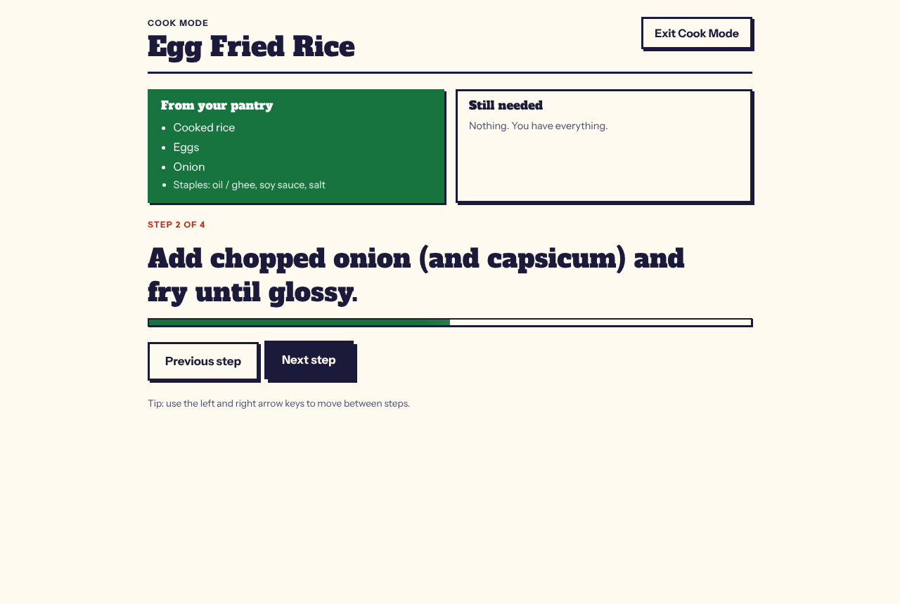
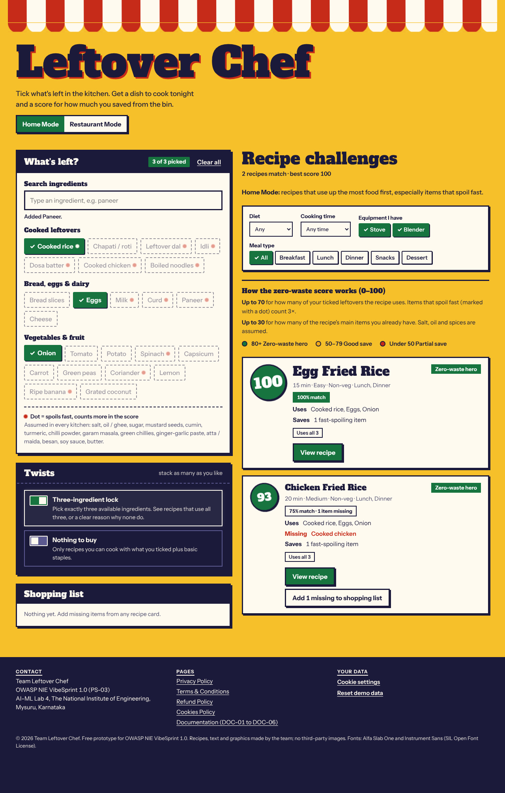
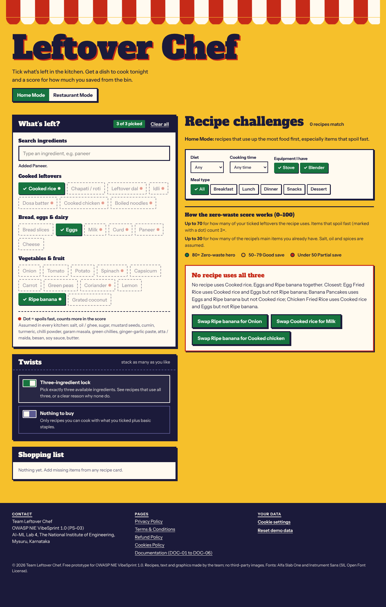
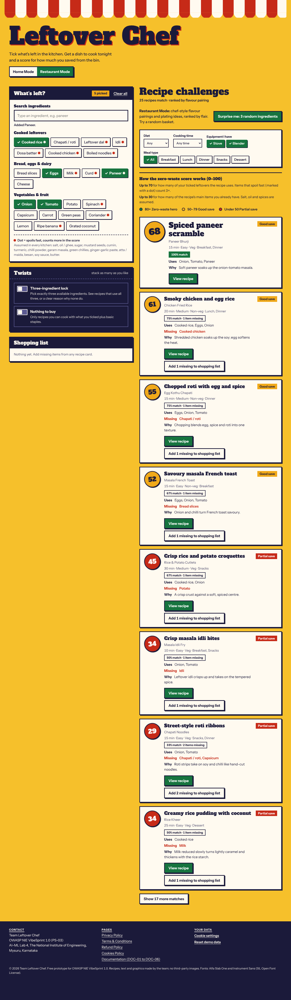

# Leftover Chef

> DOC-01 · README & Quickstart. All six documentation cards are also inside the app (footer → Documentation).

## Purpose

Leftover Chef helps a household use up leftovers before they spoil. Tick what is left, and the app matches it to 26 practical recipes, shows what is missing, and gives each recipe a zero-waste score. Built for OWASP NIE VibeSprint 1.0, problem card PS-03.

## Features

- Ingredient tag board (24 ingredients) plus a search bar with autocomplete (arrow keys + Enter).
- Quick filters: diet, cooking time, meal type (Breakfast, Lunch, Dinner, Snacks, Dessert) and equipment (stove, blender).
- Match badges such as "67% match · 1 item missing", missing-item alerts and a shopping list.
- Zero-waste score (0-100) with a visible breakdown.
- Cook Mode: one step at a time, with "From your pantry" and "Still needed" side by side.
- Home Mode (use up food that spoils fast) and Restaurant Mode (flavour pairings, plated names, plating tips, "Surprise me" random basket).
- Twist: Three-ingredient lock. Pick exactly three; see recipes that use all three or a clear reason why none do.
- Privacy, Terms, Refund and Cookies pages, and a cookie banner with an opt-in checkbox.

## Setup (no secrets)

1. Download or clone this folder.
2. Open index.html in any modern browser, or double-click dist/leftover-chef.html (the whole app in one file). Nothing to install; no API keys, no .env file, no internet needed.
3. Optional: run node tests/engine.test.js to check the logic.

## Demo data

All data is sample data written by the team in js/data.js: 24 ingredients, 26 recipes and a list of kitchen staples. The app starts with Cooked rice, Eggs, Onion and Tomato ticked so there is something to see straight away.

## Zero-waste score

- Up to 70 points for how many of your ticked leftovers the recipe uses. Items that spoil fast count 3x, medium 2x, long-lasting 1x.
- Up to 30 points for how many of the recipe's main items you already have. Staples (salt, oil, spices) are assumed.
- 80+ Zero-waste hero, 50-79 Good save, under 50 Partial save.

## Screenshots













## Known limitations

- Fixed list of 26 recipes; quantities do not scale with servings.
- Only veg / non-veg is tracked, not allergens.
- Restaurant Mode ranks by a flair rating (1-5) set by the team, not by reviews.
- The shopping list stays on this device; it does not order anything.

## 30-second judge click-path

1. See the starting list: Egg Fried Rice is near the top with a match badge and score.
2. Open it, then Start Cook Mode, press Next, then Exit.
3. Turn on the Three-ingredient lock: you are asked to pick exactly 3.
4. Untick Tomato: only recipes using Cooked rice, Eggs and Onion appear.
5. Untick Onion, type "ban" in search and press Enter: a clear no-match message with swap buttons.

## All documentation cards

- [DOC-01 · README & Quickstart](docs/DOC-01-readme-quickstart.md)
- [DOC-02 · Judge Runbook (60 seconds)](docs/DOC-02-judge-runbook.md)
- [DOC-03 · Five-Test Checklist](docs/DOC-03-five-test-checklist.md)
- [DOC-04 · User Quickstart](docs/DOC-04-user-quickstart.md)
- [DOC-05 · Data & Privacy Note](docs/DOC-05-data-privacy-note.md)
- [DOC-06 · Handoff & Limitations](docs/DOC-06-handoff-limitations.md)

## Adding a twist (about 5 minutes)

Open `js/twists.js`, copy the TEMPLATE at the bottom and fill in only the hooks you need. The toggle appears in the UI by itself.

```js
LC.Twists.register({
  id: "budget",
  label: "Student budget",
  description: "Only recipes where you buy at most one thing.",
  filter: function (result) { return result.missing.length <= 1; },
});
```

| Hook | Use it to… |
|---|---|
| `maxSelect: n` | limit how many ingredients can be ticked |
| `tag: "text"` | show a small highlight label next to the twist |
| `param: {label,min,max,step,value,unit}` | add a slider (read `ctx.params[id]`) |
| `validate(ctx)` | return a message to block results until a rule is met |
| `filter(result, ctx)` | keep or drop a recipe |
| `adjustScore(result, ctx)` | change the score |
| `badge(result, ctx)` | put a small tag on the card |
| `noMatch(ctx)` | explain why nothing matched and offer `suggestions` |

## Run the tests

- Logic: `node tests/engine.test.js`
- Browser (five-test checklist, screenshots, demo video): `python3 tests/e2e.py` (needs `pip install playwright && playwright install chromium`)

## Single-file version

`dist/leftover-chef.html` is the whole app in one file (styles, code, fonts and screenshots inlined). Double-click it; no other files or internet needed. Rebuild it after any change with `python3 scripts/build-single.py` (needs `pip install pillow`), and test it with `LC_FILE=dist/leftover-chef.html python3 tests/e2e.py`.

